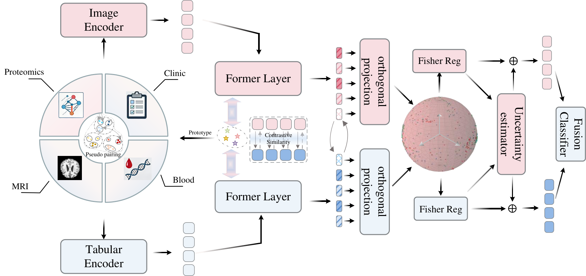

# Fisher-informed Progressive Contrastive Learning for Reliable Multimodal Dementia Diagnosis

PyTorch implementation of **FiPCL**, a framework for reliable multimodal dementia diagnosis using structural MRI and tabular data.

## Introduction

Combining structural MRI with clinical features, blood transcriptomics, or proteomics can improve dementia diagnosis. However, when a tabular modality provides weak task-related information, its noisy gradients can interfere with multimodal learning and degrade the joint representation.

FiPCL addresses this problem by estimating modality reliability through empirical Fisher information over modality-specific projector parameters. These estimates guide auxiliary supervision and cross-modal alignment. Prototype-structured contrastive learning organizes the embedding space, while progressive pseudo-pairing incorporates additional tabular-only samples through a reliability-aware confidence curriculum.

The framework studies three MRI–tabular pairs: **MRI–Clinic**, **MRI–Blood**, and **MRI–Proteomics**, for classification of cognitively normal (CN), mild cognitive impairment (MCI), and Alzheimer's disease (AD) subjects.

## Framework



**Overview of FiPCL.** Independent MRI encoders and modality-specific tabular encoders map heterogeneous inputs into a common embedding space. Each modality pair uses a fusion module with uncertainty gating, cross-attention, and orthogonal projection. Fisher information guides adaptive modality weighting and cross-modal alignment. Class-conditional prototypes support contrastive learning and progressive pseudo-pairing for the blood and proteomics branches; the clinical branch does not maintain a prototype bank.

## Key Components

- **Adaptive Fisher reweighting:** estimates modality-specific task sensitivity to adjust auxiliary supervision and cross-modal alignment.
- **Prototype-structured contrastive learning:** maintains class-conditional anchors to stabilize the latent space.
- **Progressive pseudo-pairing:** uses a reliability-aware confidence curriculum to incorporate tabular-only samples.
- **Uncertainty-aware fusion:** combines MRI and tabular representations through sample-specific gating and cross-attention.

## Repository Structure

```text
FiPCL/          Training entry point, data loading, models, and training logic
model/          MRI and tabular encoders and fusion modules
configs/        Training defaults and configurable data paths
scripts/        Data splitting, subject protection, training, and evaluation
tests/          Reproducibility checks
assets/         Framework figure
```

## Requirements

Python 3.11 or later. Install the dependencies from the repository root:

```bash
pip install -r requirements.txt
```

Training settings are defined in `configs/training.py`. Data locations can be configured through the environment variables documented in `configs/paths.py`. MRI volumes and tabular datasets must be obtained and prepared separately.

## License

See [LICENSE](LICENSE) for the terms of use.
